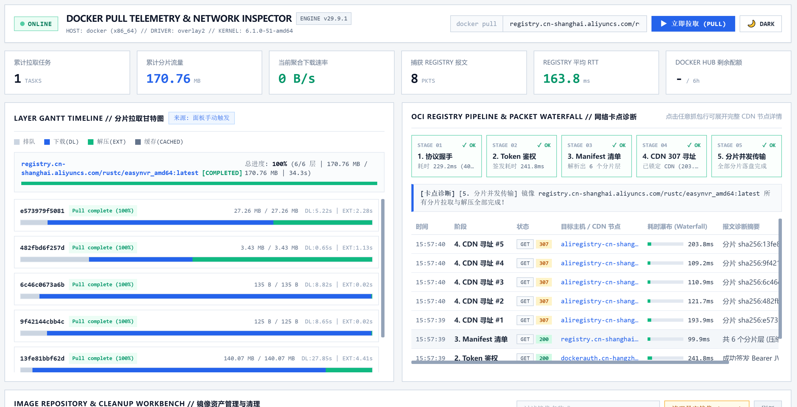

# 🐳 Docker Pull Telemetry & Network Inspector

> 一个专为 Homelab 和开发者设计的轻量级、工业遥测风格的 **Docker 镜像实时拉取监控、OCI Registry 5阶段网络卡点诊断 & Portainer 堆栈部署甘特图** 运维面板。

<div align="center">
  
</div>

---

## 🚀 核心特性 (Features)

1. **📦 实时分片 (Layer) 进度矩阵**
   * 突破标准 Docker Engine API 限制，实时捕获每一个分片层的下载 (`DL`)、解压 (`EXT`)、排队与缓存复用 (`CACHED`) 状态。
   * 内置总进度条、预估剩余时间 (ETA) 与单层实时速率计算 (`MB/s`)。
2. **🌐 OCI Registry 5阶段网络卡点诊断**
   * 自动对 `协议握手` → `Token 鉴权` → `Manifest 清单` → `CDN 307 寻址` → `分片传输` 5 阶段进行毫秒级卡点追踪。
   * 自动解析 CDN 真实落地 IP、DNS 耗时以及云厂商归属（Cloudflare、AWS S3、GitHub CDN、阿里云 OSS 等）。
3. **📊 堆栈部署与守护进程实时甘特图 (Gantt Chart)**
   * 双引擎驱动：后台常驻常态监听宿主机 `/events` 事件流，零配置自动捕捉网络创建、数据卷挂载、容器启动全过程。
   * 支持 `/docker-api` 透明代理网关，100% 完整捕捉 Portainer 堆栈部署的毫秒级时间轴。
4. **🚢 Portainer 堆栈联动工作台**
   * 绑定 Portainer Access Token (`ptr_xxx`) 后，可一键预览堆栈 `docker-compose.yml` 源码，并提供【可视重部署】按钮。
5. **🧹 宿主机磁盘空间透视与资产管理**
   * 完美集成 `/system/df` 接口，直观展示镜像、容器读写层、数据卷与构建缓存占用，支持一键清理 (`PRUNE`) 与单镜像独立删除。
6. **🛑 安全可控与工业风 UI**
   * 提供【停止拉取 (ABORT)】按钮，可随时强行中止异常挂起的拉取流；支持亮/暗（Light/Dark）双主题自由切换。

---

## 🛠️ 一键快速部署 (Quick Start)

你可以直接通过 Docker Hub 远程镜像拉取运行，无需在本地编译源码：

1. 在宿主机新建一个目录，并保存以下 `docker-compose.yml` 文件：

```yaml
services:
  docker-pull-monitor:
    image: chajian/docker-pull-monitor:latest
    container_name: docker-pull-monitor
    restart: unless-stopped
    ports:
      - "8001:8000"
    volumes:
      - /var/run/docker.sock:/var/run/docker.sock
      - ./data:/app/data
      - /etc/localtime:/etc/localtime:ro
    environment:
      - TZ=Asia/Shanghai
      - DB_FILE=/app/data/monitor.db
```
在该目录下执行后台启动命令：

Bash
docker compose up -d
打开浏览器访问：http://你的服务器IP:8001 即可体验。

⚙️ 进阶：Portainer 联动配置
如果你希望在 Portainer 原生页面点部署时同步记录甘特图：

进入 Portainer -> Environments -> 修改你的环境 URL 为 http://宿主机局域网IP:8001/docker-api（或直接在面板绑定 Portainer Token 进行堆栈可视化管理）。

📜 开源协议
本项目采用 MIT License 开源协议。
